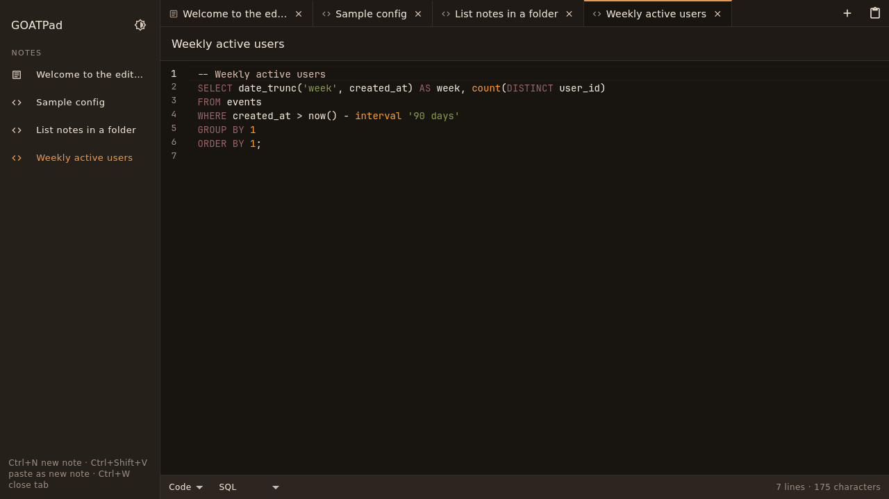

# GPad

GPad (built in this GOATPad repository: the greatest notepad of all time) is a
fast, Sublime-style notepad that keeps everything you paste and syncs it
between your computers, end-to-end encrypted, through storage you already
have.

Paste something on your Windows work machine, close the window, and find it
waiting in a tab on your Linux machine at home.



## Status

Early. Step 2, the local notepad, is under way: notes are saved as you type
and your tabs come back when you reopen GPad. Folders, search and sync are
still to come.

| Step | What it delivers | State |
| --- | --- | --- |
| 1. Foundations | Flutter app for Windows and Linux, CI, design note, editor lab | Done |
| 2. Local notepad | Autosave, session restore, folders and tab groups, search, saved settings | In progress: saving, restore, trash and settings are in; folders and search next |
| 3. Encrypted sync | Google Drive and sync-folder backends, end-to-end encryption | Planned |
| 4. Release | GitHub Releases, Windows installer, Flatpak | Planned (.deb and AppImage already built by CI) |

See [docs/design.md](docs/design.md) for how it is meant to work and why.

## What makes it different

- **Smart modes.** Each note is Rich (Markdown underneath), Code (syntax
  highlighted) or Plain, picked automatically from what you first paste and
  changeable with one click.
- **Nothing lost.** No save prompts. Closing a tab keeps the note, marked
  closed, so tabs stay tidy without throwing anything away.
- **Private sync.** Notes are encrypted on your device before they reach
  Google Drive or your sync folder. There is no GPad server.
- **Your look.** Warm, Classic or Slate themes, each in light and dark, and
  code colors you can switch to a colorblind-safe or high-contrast scheme.

## Try it

1. Press Ctrl+N and paste code, JSON, an email or a Markdown list. Watch the
   mode and the suggested name change.
2. Close GPad without saving, then open it again. Your tabs, and what you
   typed, are still there.
3. Close a tab with Ctrl+W and reopen it from the sidebar. Right-click a note
   to move it to the trash, where it stays for 30 days.
4. Open **Appearance** (the palette button) to try the themes and code
   colors. GPad remembers your choice.

## Where your notes are

GPad keeps everything in one SQLite file, `notes.db`:

- **Linux:** `~/.local/share/gpad/` (or `$XDG_DATA_HOME/gpad/`)
- **Windows:** `%LOCALAPPDATA%\GPad\`

Set `GPAD_DATA_DIR` to use another folder, for example to run a portable
copy from a USB stick. Only one GPad can have the file open at a time; a
second window tells you GPad is already open instead of risking your edits.

## Download a test build

Builds from CI are attached to each run under **Actions → CI → Artifacts**.
GitHub wraps each one in a zip, so unzip it first.

- **Windows:** `gpad-windows-x64`. Unzip and run `gpad.exe`. No installer or
  admin rights needed.
- **Debian or Ubuntu:** `gpad-linux-deb`. Install with
  `sudo apt install ./gpad_0.1.0_amd64.deb`, then open GPad from the app menu
  or run `gpad`.
- **Any Linux (AppImage):** `gpad-linux-appimage`. Make it executable with
  `chmod +x GPad-0.1.0-x86_64.AppImage` and run it. If it says FUSE is
  missing, install `fuse3` or start it with `--appimage-extract-and-run`.

The Linux builds run on Ubuntu 22.04, Debian 12 and anything newer, and on
current Fedora. CI installs and starts them on each of those.

## Build from source

You need [Flutter](https://docs.flutter.dev/get-started/install) 3.47 or
later.

On Linux, also install the desktop build tools:

```sh
sudo apt-get install clang cmake ninja-build pkg-config libgtk-3-dev liblzma-dev libstdc++-12-dev
```

Then:

```sh
flutter pub get
flutter test
flutter run -d linux     # or: flutter run -d windows
```

To build the Linux packages yourself:

```sh
flutter build linux --release
linux/packaging/package.sh   # writes the .deb and AppImage to dist/
```

## License

[MIT](LICENSE)
